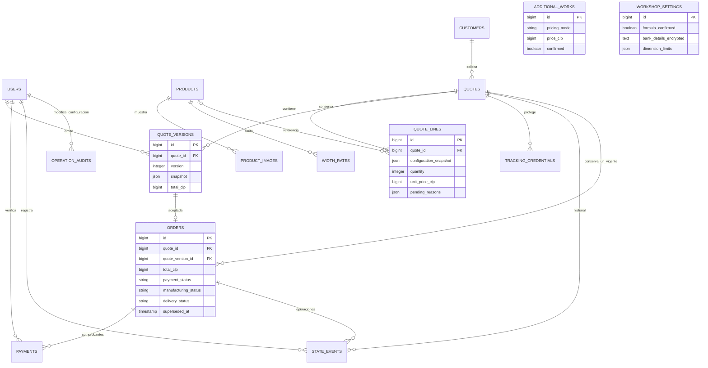

# Entidades y relaciones

Los adicionales seleccionados están embebidos en las configuraciones/snapshots comerciales; no hay FK desde el histórico que pueda alterar condiciones aceptadas. El token autoriza la cotización y el pedido asociado, no al cliente completo.
